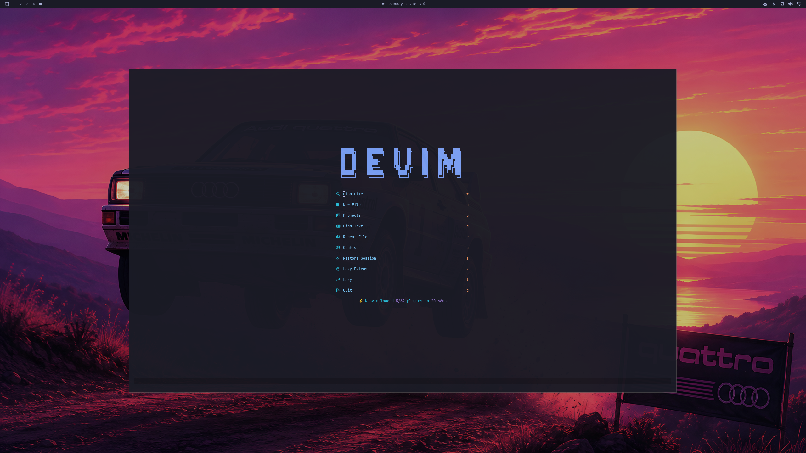

 
 
    <picture>
      
    </picture>

  
  
  
  

  
  

 

## _**Hi, my name is Devon and this is DeVim.**_

**DeVim is my personal dev tooling for full-stack development accross the major operating systems.**   
[Linux](./Linux) is the daily driver; [MacOS](./MacOS) and [Windows](./Windows) are the work machines I keep civilized.  The goal is simple: keep my workflow familiar across operating systems without pretending they’re all the same - fast, portable, and mildly overthought in all the right places.

_Feel free to explore, tweak or shamelessly steal. Most of this was stolen, remixed, broken, fixed and then stolen again anyway. Suggestions welcome. ❤️_

 
    <picture>
      
    </picture>

 

## 🛠️ Setup and Learning Resources

> ⚠️ **The bad news:**  
> This repo doesn't come with an installer, wizard, or training montage.  
> It also won't teach you how to Vim or tweak Lua.

 

> ✅ **The good news:**  
> If you know your way around a terminal, setup is pretty chill.  
> I’ve included some docs and keybinding notes to help you steal responsibly.

 
 

## 🙌 Special Thanks

Shout-out to the following people for inspiration, ideas and support:

- [@maxischmaxi](https://github.com/maxischmaxi)
- [@jayson-lennon](https://github.com/jayson-lennon)
- [@scottmckendry](https://github.com/scottmckendry)
- [@devaslife](https://www.devas.life/)
- [@tjdevries](https://github.com/tjdevries)
- [@ThePrimeagen](https://github.com/theprimeagen)
- [@JazzyGrim](https://github.com/JazzyGrim) (Sindo)
- [@David Heinemeier Hansson](https://github.com/dhh) (DHH)

---
